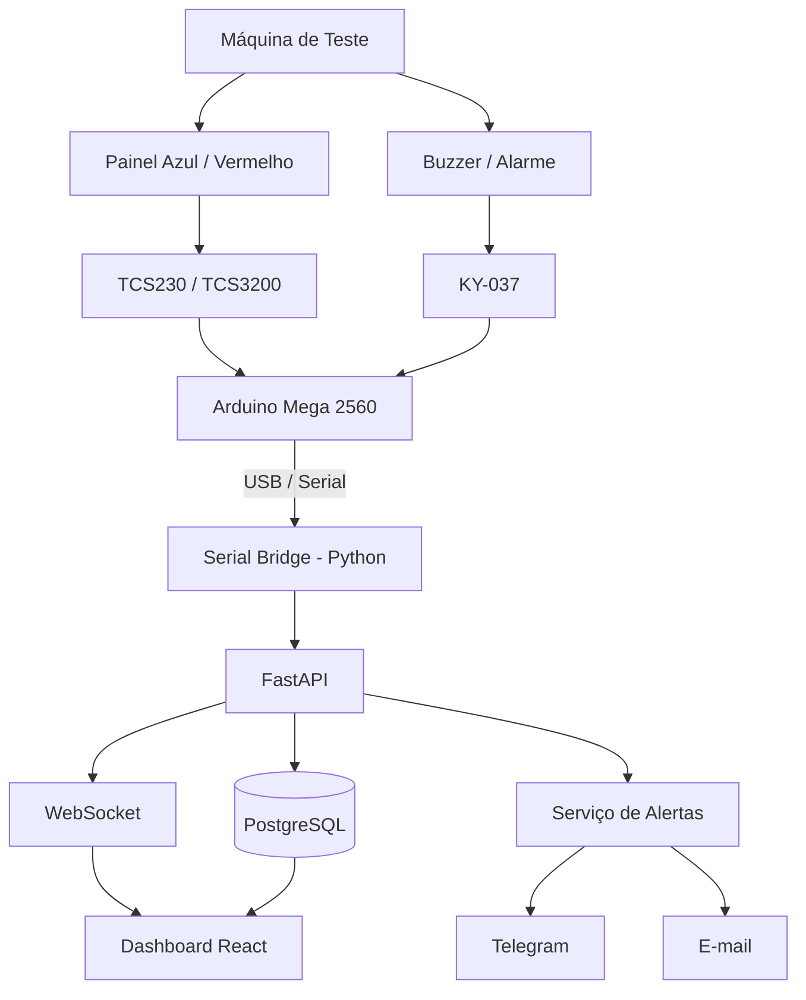
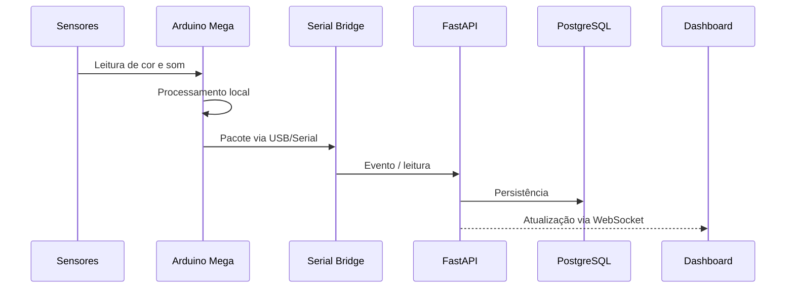
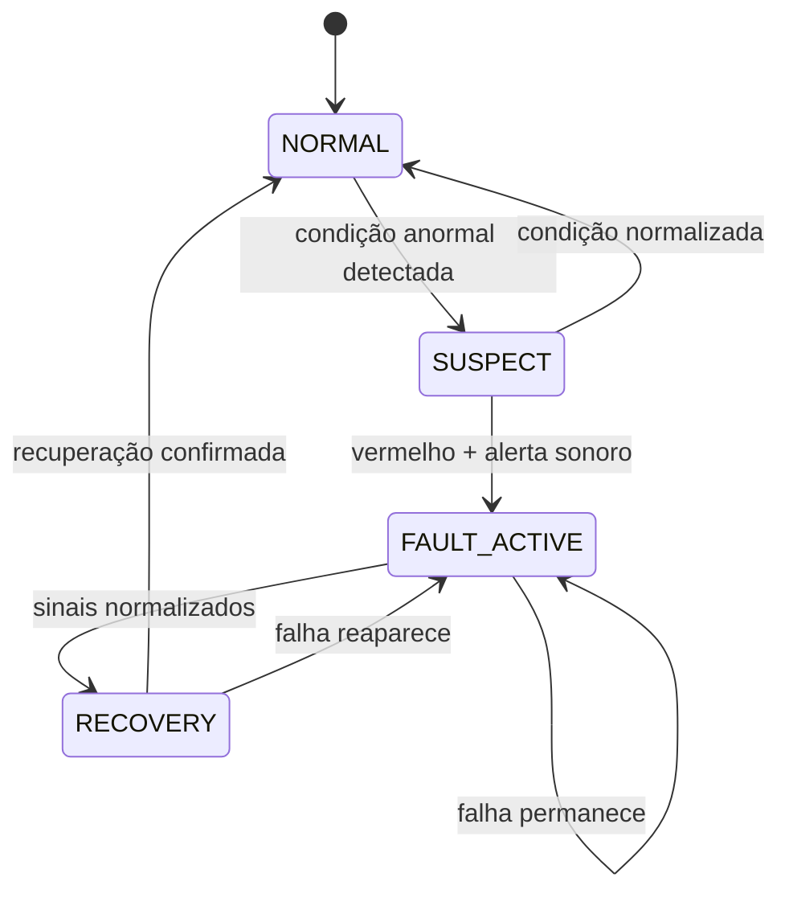

# Machine Tracker

> **Fase 6.2 — fila transacional.** Novos ciclos de falha criam alertas PENDING
> com proteção por UUID, ciclo e cooldown. Sem envio externo ou worker.
> Contrato: [docs/alert-queue.md](docs/alert-queue.md).
> Suíte atual: 319 testes passaram, nenhum ignorado.

> **Fase 6.1 — providers Telegram/e-mail.** Configuração e limites em
> [docs/providers.md](docs/providers.md). Sem disparo automático; a Fase 6
> completa ainda não está concluída. Validação da parte 1: 297 testes passaram.

> **Fase 5 — eventos implementados e validados.** Ingestão idempotente por UUID,
> consultas e reconhecimento: [docs/events.md](docs/events.md).
> Validação inicial: 227 testes; após correções: 250 passaram, nenhum ignorado.

> **Fase 4 — telemetria implementada e validada.** Ingestão e consulta de leituras,
> filtros e paginação: [docs/readings.md](docs/readings.md).
> Validação inicial: 156 testes; após correções de entradas-limite: 164 passaram.

> **Fase 3 — máquinas, dispositivos e heartbeat.** Contratos e execução em
> [docs/equipment.md](docs/equipment.md). Validação da fase: 115 testes passaram.

> **Fase 2 — autenticação implementada e validada.** Login JSON, access/refresh,
> RBAC e seed manual: [docs/authentication.md](docs/authentication.md).
> Validação ao concluir a Fase 2: 82 testes passaram.

> **Fase 1 — models, schemas e migrations aprovados implementados e validados.**
> Consulte [docs/database.md](docs/database.md) e o
> [contrato de banco aprovado](docs/database-proposal.md). Suíte: 36 testes passaram.

> **Fase 0 — bootstrap em validação.** As instruções executáveis atuais estão em
> [docs/deployment.md](docs/deployment.md), e os testes em
> [docs/testing.md](docs/testing.md). As demais seções abaixo descrevem a visão
> planejada do projeto, não funcionalidades já implementadas. O nome usado no
> bootstrap é Machine Monitor, conforme `PROJECT_MASTER_PROMPT.md`.

> Sistema de monitoramento inteligente para máquinas de teste, integrando **Arduino Mega 2560**, sensores IoT, backend web, banco de dados, dashboard em tempo real e alertas automáticos.


---

## Visão geral

O **Machine Tracker** é um protótipo de monitoramento para máquinas industriais/de teste.

O sistema observa dois sinais físicos da máquina:

- a **cor exibida no painel**, utilizando um sensor **TCS230/TCS3200**;
- a **presença de um alerta sonoro**, utilizando um módulo **KY-037**.

A leitura é feita por um **Arduino Mega 2560** e enviada via **USB/Serial** para um computador host.

No host, um serviço em Python recebe os dados, integra-se com a API do sistema e registra os eventos em banco de dados.

Quando a combinação de sinais indica uma possível falha, o sistema pode:

- registrar o evento;
- atualizar o dashboard;
- disponibilizar o histórico;
- emitir notificações;
- identificar a máquina e sua localização.

---

## Objetivo

Criar uma solução capaz de identificar automaticamente situações de falha em máquinas de teste por meio da combinação de sinais visuais e sonoros.

A regra principal do protótipo é:

```text
PAINEL VERMELHO
       +
ALERTA SONORO
       ↓
POSSÍVEL FALHA
       ↓
REGISTRO + DASHBOARD + ALERTA
```

A lógica final será calibrada experimentalmente com o hardware real.

---

## Hardware

| Componente | Função |
|---|---|
| Arduino Mega 2560 | Unidade principal de aquisição e processamento |
| TCS230 / TCS3200 | Detecção das cores apresentadas pelo painel |
| KY-037 | Detecção de intensidade/presença do alerta sonoro |
| Computador host | Executa backend, banco, frontend e bridge serial |

> O KY-037 será utilizado inicialmente para detecção de sinal sonoro por amplitude/limiar. Valores físicos como limiares de som e faixas de cor deverão ser definidos durante a etapa de calibração.

---

## Arquitetura



---

## Fluxo de dados



---

## Stack

### Embarcado

- Arduino Mega 2560
- C / C++
- TCS230 / TCS3200
- KY-037
- Comunicação USB/Serial

### Backend

- Python
- FastAPI
- Pydantic
- SQLAlchemy / SQLModel
- WebSocket

### Banco de dados

- PostgreSQL
- Migrations
- Persistência de leituras, eventos, máquinas e alertas

### Frontend

- React
- TypeScript
- Vite
- Recharts

### Infraestrutura

- Docker
- Docker Compose
- Git
- Variáveis de ambiente
- Testes automatizados

---

## Estrutura planejada

```text
machine-tracker/
│
├── firmware/
│   ├── src/
│   │   ├── sensors/
│   │   ├── detection/
│   │   ├── communication/
│   │   └── main.cpp
│   └── tests/
│
├── backend/
│   ├── app/
│   │   ├── api/
│   │   ├── models/
│   │   ├── schemas/
│   │   ├── services/
│   │   ├── repositories/
│   │   ├── alerts/
│   │   ├── websocket/
│   │   └── database/
│   └── tests/
│
├── serial-bridge/
│   ├── app/
│   └── tests/
│
├── frontend/
│   └── src/
│       ├── components/
│       ├── pages/
│       ├── hooks/
│       ├── services/
│       └── types/
│
├── database/
│   ├── migrations/
│   └── seed/
│
├── docs/
│   ├── architecture/
│   ├── decisions/
│   ├── hardware/
│   └── api/
│
├── AGENTS.md
├── PROJECT_MASTER_PROMPT.md
├── docker-compose.yml
├── .env.example
└── README.md
```

---

## Exemplo de evento

```json
{
  "device_id": "machine-01",
  "color": "RED",
  "sound_trigger": true,
  "sound_amplitude": 612,
  "timestamp_ms": 154300
}
```

Os valores e campos finais do protocolo devem permanecer sincronizados entre firmware, bridge serial e backend.

---

## Estados do sistema

Uma possível máquina de estados para o projeto:



A lógica deverá evitar o envio repetitivo de alertas enquanto uma mesma falha permanecer ativa.

---

## Dashboard

A aplicação web deverá disponibilizar:

- autenticação;
- resumo do estado das máquinas;
- status atual;
- histórico de eventos;
- gráficos;
- tabela de leituras;
- visualização de falhas;
- configuração de alertas;
- acompanhamento em tempo real.

Exemplo conceitual:

```text
┌──────────────────────────────────────────────┐
│ MACHINE TRACKER                             │
├──────────────┬───────────────┬───────────────┤
│ Máquinas     │ Normais       │ Em falha      │
│     08       │      07       │      01       │
├──────────────┴───────────────┴───────────────┤
│                                              │
│          Eventos nas últimas 24h             │
│                                              │
│          █                                   │
│     █    █                                   │
│ █   █    █       █                           │
│──────────────────────────────────────────────│
│ MACHINE-001     🔴 FALHA                     │
│ MACHINE-002     🟢 NORMAL                    │
│ MACHINE-003     🟢 NORMAL                    │
└──────────────────────────────────────────────┘
```

---

## Alertas

Ao confirmar uma falha, o sistema poderá gerar uma mensagem semelhante a:

```text
⚠ ALERTA DE FALHA

Máquina: MACHINE-XYZ
Número de série: XYZ
Local: Bloco X — Corredor Y

Painel: VERMELHO
Alerta sonoro: DETECTADO

Favor verificar o equipamento imediatamente.
```

Canais inicialmente previstos:

- Telegram;
- e-mail.

Outros canais podem ser adicionados posteriormente através de providers independentes.

---

## Desenvolvimento com Codex

O projeto utiliza:

- `PROJECT_MASTER_PROMPT.md` como especificação técnica principal;
- `AGENTS.md` como conjunto de regras para agentes de desenvolvimento;
- OpenAI Codex no Visual Studio Code para implementação assistida.

A estratégia recomendada é trabalhar em pequenas tarefas verificáveis:

```text
READ
  ↓
INSPECT
  ↓
PLAN
  ↓
IMPLEMENT
  ↓
TEST
  ↓
REVIEW
  ↓
COMMIT
```

O agente não deve implementar múltiplas fases do projeto em uma única tarefa.

---

## Roadmap

- [ ] Bootstrap do monorepo
- [ ] Docker Compose
- [ ] PostgreSQL
- [ ] Backend FastAPI
- [ ] Modelagem do banco
- [ ] Autenticação
- [ ] API de máquinas
- [ ] API de leituras
- [ ] API de eventos
- [ ] WebSocket
- [ ] Simulador de sensores
- [ ] Dashboard React
- [ ] Histórico e gráficos
- [ ] Sistema de alertas
- [ ] Serial Bridge em Python
- [ ] Firmware Arduino Mega 2560
- [ ] Driver TCS230/TCS3200
- [ ] Integração KY-037
- [ ] Máquina de estados
- [ ] Integração Arduino → Host → API
- [ ] Calibração física
- [ ] Testes integrados
- [ ] Validação final do protótipo

---

## Execução local

> Esta seção histórica descreve o fluxo planejado. Para o bootstrap atual, siga
> [as instruções da Fase 0](docs/deployment.md), incluindo todas as variáveis
> obrigatórias. Não é necessário Arduino ou PlatformIO para esta fase.

### Pré-requisitos

- Git
- Docker
- Docker Compose
- Python
- Node.js
- Arduino IDE ou PlatformIO

### Clonar

```bash
git clone <URL_DO_REPOSITORIO>
cd machine-tracker
```

### Variáveis de ambiente

```bash
cp .env.example .env
```

Configure as variáveis necessárias no `.env`.

Nunca versione credenciais reais.

### Infraestrutura

```bash
docker compose up -d
```

### Backend

```bash
cd backend
python -m venv .venv
```

Linux/macOS:

```bash
source .venv/bin/activate
```

Windows:

```powershell
.venv\Scripts\Activate.ps1
```

Depois:

```bash
pip install -r requirements.txt
```

### Frontend

```bash
cd frontend
npm install
npm run dev
```

---

## Testes

Cada camada deverá ser validada separadamente.

```text
Firmware
   ↓
Serial Bridge
   ↓
Backend
   ↓
Database
   ↓
WebSocket
   ↓
Frontend
   ↓
Integração
```

Sempre diferenciar:

### Validável automaticamente

- testes unitários;
- testes de API;
- validação de schemas;
- build do frontend;
- lint;
- parser serial;
- migrations;
- testes de integração simulada.

### Requer hardware real

- identificação correta de vermelho e azul;
- limiar adequado do KY-037;
- comportamento em ambiente ruidoso;
- posicionamento dos sensores;
- calibração;
- estabilidade do sistema em operação real.

---

## Documentação

A documentação técnica do projeto ficará em:

```text
docs/
```

Decisões importantes de arquitetura devem ser registradas como ADRs:

```text
docs/decisions/
├── ADR-001-postgresql.md
├── ADR-002-serial-communication.md
├── ADR-003-arduino-mega.md
└── ADR-004-fault-detection.md
```

---

## Segurança

O projeto deverá seguir algumas regras mínimas:

- não versionar senhas;
- não versionar tokens;
- não versionar chaves de API;
- utilizar `.env`;
- manter `.env.example`;
- validar entradas da API;
- utilizar autenticação;
- controlar permissões;
- registrar eventos relevantes.

---

## Princípio de projeto

> O hardware coleta.  
> O firmware interpreta.  
> O host transporta.  
> A API organiza.  
> O banco preserva.  
> O dashboard apresenta.  
> O sistema de alertas reage.

---

## Status

🚧 **Projeto em desenvolvimento**

O protótipo está sendo construído de forma incremental, com validação individual de cada camada antes da integração física definitiva.

---

## Autor

Projeto desenvolvido como trabalho técnico/acadêmico envolvendo:

**Sistemas Embarcados · IoT · Engenharia de Software · Desenvolvimento Full Stack**

---

<p align="center">
  <strong>Machine Tracker</strong><br>
  Monitoramento inteligente de máquinas através de sensores IoT e aplicações web.
</p>
